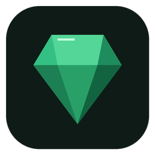
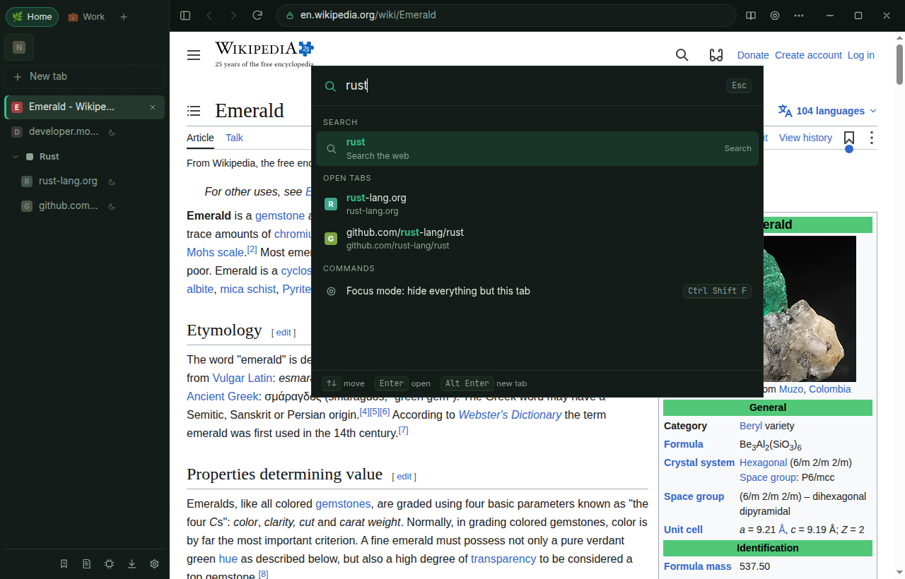
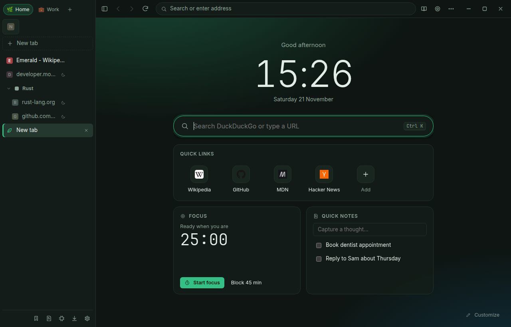
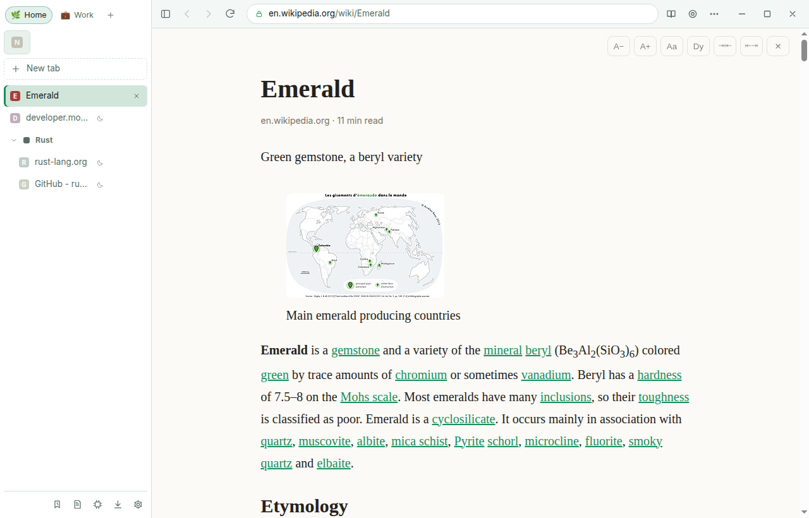
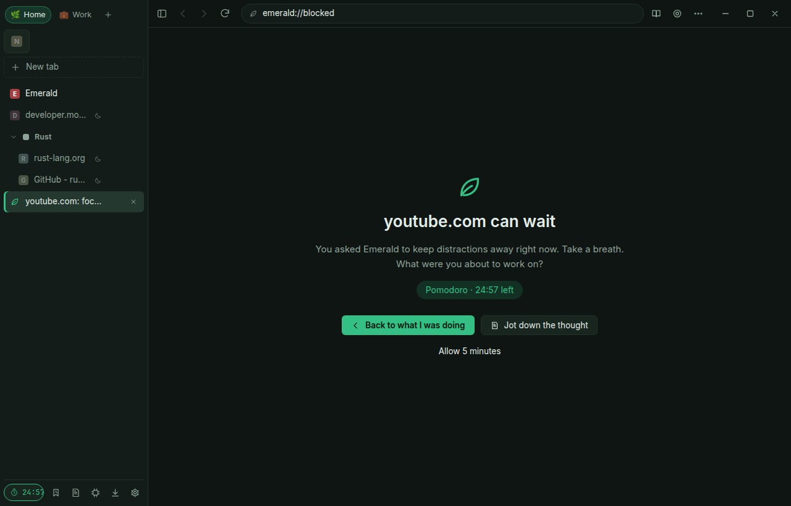
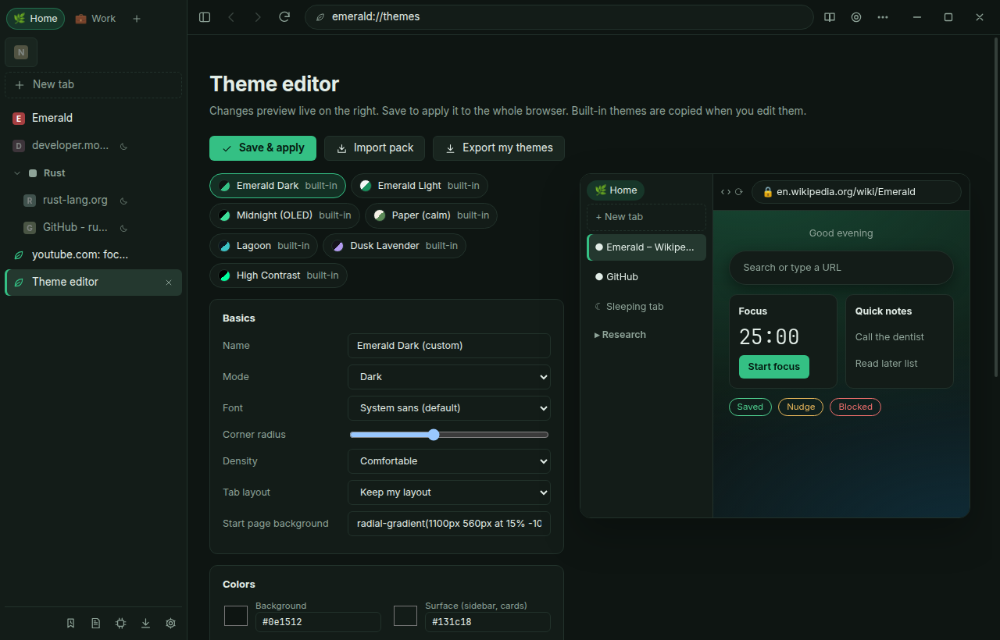

<p align="center">
  
</p>

<h1 align="center">Emerald</h1>

<p align="center"><b>A calm, minimal, ultra-customizable browser for people who get distracted, with a Rust shell over Chromium.</b></p>

<p align="center">
  <a href="https://github.com/ZDStudios/emerald/releases/latest"><b>Download</b></a> ·
  <a href="RUNNING.md">How to run</a> ·
  <a href="FEATURES.md">Features</a> ·
  <a href="BENCHMARKS.md">Benchmarks</a>
</p>



| | |
|---|---|
|  |  |
| **Start page:** drawn by the shell, with draggable widgets | **Reader mode** in the Emerald Light theme |
|  |  |
| **Focus time:** distracting sites wait, gently | **Theme editor** with live preview |

Emerald has a thin top bar and a compact sidebar, and both can hide themselves. Idle tabs go to sleep so
they stop using memory. Focus tools are built in: a site blocker, Pomodoro, "park this tab for later",
quick notes, reader and video modes. Every color, font, radius and layout is a theme you can edit live.

## Honest notes up front

* **The engine is Chromium.** No Rust engine can render the modern web or run Chrome extensions.
  Emerald embeds Chromium through CEF (Chromium Embedded Framework), and everything around it is
  Rust: windows, tabs, settings, import, extension glue, focus tools and the memory manager.
  The interface itself is HTML/CSS/JS rendered by the engine (see [ARCHITECTURE.md](ARCHITECTURE.md) for why).
* **Chromium can't use "no RAM".** A single page costs about 450 MB. What Emerald can do is avoid
  holding pages you aren't using: sleeping tabs, lazy restore, and a one-click "Free memory".
  With 20 tabs in a restored session, that's about **2.7 GB if every tab is loaded versus about 450 MB with lazy restore** (see [BENCHMARKS.md](BENCHMARKS.md)).
* **No Chrome Sync.** Google only offers it to Chrome, and Microsoft only offers Edge sync to Edge. Emerald
  imports from both instead, and works with password-manager extensions such as Bitwarden.
* **Tested on Linux (X11).** Windows is the primary target. The code has Windows paths and a
  GitHub Actions workflow builds Windows installers, but those builds have **not yet been run or tested on a
  real Windows machine**. macOS support is written but its build is paused for now.

The full list of what is done, partial or not possible is in [FEATURES.md](FEATURES.md).
**To install and run a build, see [RUNNING.md](RUNNING.md).**

## Highlights

| | |
|---|---|
| **Minimal UI** | Vertical or horizontal tabs; sidebar and top bar can auto-hide; focus mode shows only the page. |
| **Command bar** (`Ctrl K`) | Fuzzy search over open tabs, parked tabs, bookmarks, history and every command. Type a URL or search. |
| **Organization** | Spaces (workspaces), pinned tabs, folders, colored groups, drag-and-drop, split view. |
| **Start page** | Drawn by the shell itself (no extra process). Draggable, resizable widgets: clock, search, links, focus timer, notes, parked tabs. |
| **Extensions** | Click **"Add to Emerald"** on the Chrome Web Store or Edge Add-ons. Includes a manager, toolbar pins and popups. Tested with uBlock Origin Lite, Bitwarden, Dark Reader and React DevTools. |
| **ADHD-friendly** | Site blocker with schedules, Pomodoro, focus sessions, tab-limit and distraction nudges, park-with-reminder, quick notes, reader mode, distraction-free video mode, reduced motion, OpenDyslexic, big targets, quiet by default. |
| **Memory** | Automatic tab sleeping, lazy restore, per-tab memory meter (`Ctrl Shift M`), "Free memory". |
| **Themes** | 7 built-in themes (Emerald Dark/Light default), a live editor, custom CSS, importable/exportable theme packs. |
| **Privacy** | No telemetry. Built-in lightweight tracker blocker, HTTPS-First, third-party cookie blocking, DNT/GPC, per-site permissions, and a password vault encrypted locally (AES-256-GCM, with the key protected by DPAPI on Windows). |
| **Import** | Bookmarks, history and passwords read from Chrome/Edge profile folders, plus HTML bookmark and CSV password files. |

## Keyboard shortcuts

| Keys | | Keys | |
|---|---|---|---|
| `Ctrl K` / `Ctrl L` | Command bar / address | `Ctrl Shift F` | Focus mode |
| `Ctrl T` / `Ctrl W` | New / close tab | `Ctrl Shift P` | Park tab for later |
| `Ctrl Shift T` | Reopen closed tab | `Ctrl Shift N` | Quick note |
| `Ctrl Tab` / `Ctrl 1–9` | Switch tabs | `Ctrl Shift E` | Split view |
| `Ctrl F` | Find in page | `Ctrl Shift R` | Reader mode |
| `Ctrl D` | Bookmark | `Ctrl Shift M` | Memory meter |
| `Ctrl H` / `Ctrl J` | History / downloads | `Ctrl Shift S` | Toggle sidebar |
| `F12` | DevTools | `Ctrl P` | Print |

## Building

Requirements: Rust (stable, 1.85+), CMake 3.21+, Ninja, a C++ compiler (MSVC on Windows, g++/clang on Linux).

```bash
# 1. Fetch the CEF binary distribution matching the `cef` crate (≈1.5 GB unpacked)
cargo install export-cef-dir --version 156.7.0 --locked
export-cef-dir --force ~/.local/share/cef
export CEF_PATH=~/.local/share/cef            # Windows: $env:CEF_PATH = "$env:USERPROFILE\.local\share\cef"

# 2. Build and run
cargo build --release -p emerald
LD_LIBRARY_PATH=$CEF_PATH target/release/emerald      # Windows: add $env:CEF_PATH to PATH, run target\release\emerald.exe

# 3. Tests (core logic needs no CEF; the browser crate's tests link libcef)
cargo test -p emerald-core
LD_LIBRARY_PATH=$CEF_PATH cargo test -p emerald
```

Packaging:

```bash
scripts/package-linux.sh 0.1.0                  # → dist/emerald-0.1.0-linux-x64.tar.gz
```

```powershell
.\scripts\package-windows.ps1 -Version 0.1.0    # → dist\Emerald-0.1.0-setup-x64.exe + portable zip (needs Inno Setup 6)
```

Pushing a tag `v*` runs [`.github/workflows/release.yml`](.github/workflows/release.yml). It builds both platforms, runs the tests,
packages them and publishes a GitHub release.

### Developer tips

* `EMERALD_UI_DIR=$PWD/ui` serves the interface from disk, so UI edits only need a page reload.
* `--profile=<dir>` uses an isolated profile; `--remote-debugging-port=9222` enables DevTools access.
* `crates/emerald-probe` drives a running build over DevTools (`targets`, `eval`, `shot`, `logs`, `mem`).
  The automated checks in this repo were run with it.
* `EMERALD_DEBUG=1` prints extra logs.

## Layout

```
crates/emerald        the browser: CEF app, window, tabs, API, extensions, focus, privacy
crates/emerald-core   engine-independent logic (unit tested): settings, sessions, themes,
                      importers, CRX verification, vault, fuzzy search
crates/emerald-probe  DevTools-based test and benchmark harness
ui/                   the interface (plain ES modules, embedded at build time)
themes/               built-in themes
spike/cef-spike       Phase 0 engine spike
packaging/, scripts/  installers and benchmarks
```

## Privacy

Emerald sends nothing anywhere on its own: no telemetry, no crash reports, no "phone home". All
network traffic comes from pages you open, extensions you install, and Chromium's own component and
extension updates. History, notes, sessions and the password vault live in your profile folder
(`%LOCALAPPDATA%\Emerald`, `~/.local/share/emerald`).

## License

MIT or Apache-2.0, at your option. Chromium/CEF are BSD-licensed. OpenDyslexic is under the SIL
Open Font License (see `ui/fonts/OpenDyslexic-OFL.txt`).
